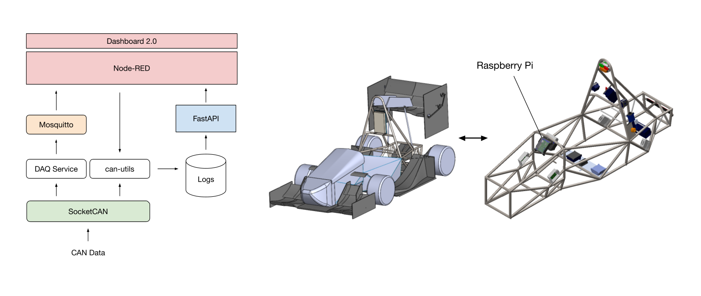

# FRUCD Telemetry Software

## Hardware
| Component | Description |
|------------|-------------|
| [Raspberry Pi 4 Model B](https://www.raspberrypi.com/products/raspberry-pi-4-model-b/) | Running Debian 12 (Bookworm) with Python 3.11 |
| [Waveshare 2-CH CAN HAT](https://www.waveshare.com/wiki/2-CH_CAN_HAT) | Dual MCP2515 SPI CAN interface for vehicle data |
| [4" IPS Touchscreen LCD Display (800×480)](https://www.amazon.com/dp/B07XBVF1C9) | HDMI touchscreen display for dashboard |
| [Mobile Router Industrial](https://store.ui.com/us/en/category/internet-solutions/collections/unifi-mobile-routing/products/umr-industrial-us) | WiFi router designed for indoor/outdoor IoT applications |

## Data Collection Procedure

### Prerequisites
- Device with an internet connection
- WireGuard VPN tunnel activated (configuration file provided by Software Lead)

### Procedure

1. **System Startup**
   - Activate LV to power the Raspberry Pi and cellular modem.
   - Raspberry Pi automatically starts telemetry services and begins logging CAN bus data.
   - Verify logging status through the driver dashboard or Telemetry GUI.

2. **Driving Session**
   - Begin driving session.
   - Access the Telemetry GUI through a web browser to view live vehicle data and monitor logging status.

3. **Data Processing**
   - End driving session.
   - Stop CAN bus logging through the Telemetry GUI.
   - Raspberry Pi backend processes recorded data and generates CSV and PDF reports.

4. **Data Retrieval & Shutdown**
   - Download the ZIP archive containing the raw CAN log, parsed CSV, and PDF report.
   - Switch off LV to power down the telemetry system.